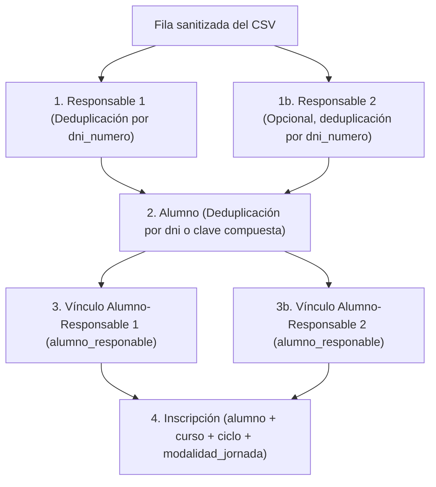

# Guía canónica de ingesta de estudiantes y cursada

Actualizado: 31 de octubre de 2026.

## 1. Propósito y alcance

Este documento establece el contrato, las especificaciones de datos y el procedimiento operativo para la ingesta masiva de alumnos, responsables, vínculos e inscripciones escolares en PocketBase mediante hojas de cálculo maestras institucionales (Google Sheets exportadas a CSV).

Aplica tanto para **Nivel Primario** (1.° a 7.° grado) como para **Nivel Inicial (Jardín de Infantes)** con sus dos salas unificadas (*Sala de 2 y 3 años* y *Sala de 4 y 5 años*).

---

## 2. Reglas de privacidad y seguridad

- **PII y confidencialidad:** Los archivos CSV exportados con datos de menores y familias reales **nunca deben commitearse en Git**, incluirse en PRs ni almacenarse en carpetas bajo control de versiones.
- **Entorno de pruebas:** Probar siempre la ingesta primero en el entorno local (`127.0.0.1:8090`) mediante el modo `--dry-run` y posteriormente `--execute`. Solo promover y ejecutar en producción (`https://alumnos-api.duckdns.org`) tras completar la verificación relacional y visual.
- **Semilla de desarrollo (`deploy/pocketbase-dev-seed`):** Permanece 100% sintética según el contrato de `AGENTS.md`. No incorporar registros de estudiantes reales a los seeds.

---

## 3. Especificación de columnas de la Hoja Maestra (Google Sheets)

El CSV exportado debe estar codificado en UTF-8 y contener los siguientes encabezados (separados por coma):

```csv
alumno_dni,alumno_apellidos,alumno_nombres,alumno_legajo,alumno_fecha_nacimiento,alumno_sexo,alumno_nacionalidad,alumno_domicilio,alumno_localidad,alumno_usuario_acadeu,alumno_clave_acadeu,ciclo_ano,curso_nombre,numero_orden,numero_inscripcion,fecha_ingreso,fecha_inscripcion,estado_inscripcion,fecha_egreso,promociono_con_acompanamiento,posee_apoyos,cuales_apoyos,modalidad_jornada,responsable_dni_tipo,responsable_dni_numero,responsable_apellidos,responsable_nombres,responsable_vinculo,responsable_telefono,responsable_email,responsable_nacionalidad,responsable_profesion,responsable2_dni_tipo,responsable2_dni_numero,responsable2_apellidos,responsable2_nombres,responsable2_vinculo,responsable2_telefono,responsable2_email,responsable2_nacionalidad,responsable2_profesion
```

> [!NOTE]
> Se admite `jornada` como alias de encabezado alternativo para `modalidad_jornada`. Asimismo, se admite de forma tolerante el encabezado tipográfico `responsable_dni_nnumero` o `responsable2_dni_nnumero`.

### Especificación detallada de campos

| Campo | Obligatorio | Formato / Valores admitidos | Notas |
| --- | --- | --- | --- |
| `alumno_dni` | No (opcional en Inicial) | Dígitos numéricos sin puntos | Si está vacío o en trámite, se deduplica por clave compuesta `apellidos\|nombres\|fecha_nacimiento`. |
| `alumno_apellidos` | Sí | Texto en mayúsculas / minúsculas | Apellidos completos del estudiante. |
| `alumno_nombres` | Sí | Texto | Nombres de pila del estudiante. |
| `alumno_legajo` | No | Texto o numérico | Opcional en Inicial; dejar celda en blanco si no se asignó. |
| `alumno_fecha_nacimiento` | No (recomendado) | `YYYY-MM-DD` o `YYYY/MM/DD` | Fundamental para la deduplicación de alumnos sin DNI. |
| `alumno_sexo` | No | `Femenino`, `Masculino`, `No binario`, `Otro` | Valores exactos admitidos por el backend. |
| `alumno_nacionalidad` | No | Texto (ej. `Argentina`) | Dejar vacío si se desconoce. |
| `alumno_domicilio` | No | Texto libre | Calle, número, piso/depto. |
| `alumno_localidad` | No | Texto (ej. `CABA`, `Olivos`) | Localidad de residencia. |
| `alumno_usuario_acadeu` | No | Texto | Vacío en Inicial si no se opera plataforma Acadeu. |
| `alumno_clave_acadeu` | No | Texto | Vacío en Inicial si no se opera plataforma Acadeu. |
| `ciclo_ano` | Sí | Año numérico (ej. `2026`) | Debe existir previamente en `ciclos_lectivos`. |
| `curso_nombre` | Sí | Nombre de curso o sala | Soporta normalización automática (ver sección específica). |
| `numero_orden` | Sí | Entero positivo (ej. `1`, `2`, `15`) | Número de lista en el curso/sala. |
| `numero_inscripcion` | No | Texto | Identificador administrativo si existiera. |
| `fecha_ingreso` | No | `YYYY-MM-DD` | Fecha de incorporación institucional. |
| `fecha_inscripcion` | No | `YYYY-MM-DD` | Fecha administrativa de matrícula. |
| `estado_inscripcion` | Sí | `Regular`, `Baja`, `Libre` | Estado lectivo del alumno en la cursada. |
| `fecha_egreso` | Condicional | `YYYY-MM-DD` | Obligatorio únicamente si `estado_inscripcion` es `Baja`. |
| `promociono_con_acompanamiento` | No | `SI`, `NO`, `-`, o vacío | Registro pedagógico anual. |
| `posee_apoyos` | No | `SI`, `NO`, `-`, o vacío | Indicador de PPI o inclusión escolar. |
| `cuales_apoyos` | No | Texto descriptivo | Detalle del equipo o apoyos externos. |
| `modalidad_jornada` | No | `Mañana`, `Jornada Completa`, `Tarde` | Admite alias institucionales (ver sección específica). |
| `responsable_dni_tipo` | No | `DNI`, `Pasaporte`, `CI`, etc. | Por defecto `DNI`. |
| `responsable_dni_numero` | Sí | Dígitos sin puntos | Clave primaria de deduplicación del primer tutor. |
| `responsable_apellidos` | Sí | Texto | Apellidos del primer responsable. |
| `responsable_nombres` | Sí | Texto | Nombres del primer responsable. |
| `responsable_vinculo` | No | `Padre`, `Madre`, `Tutor`, etc. | Por defecto `Padre`. |
| `responsable_telefono` | No | Texto | Teléfono de contacto. |
| `responsable_email` | No | Email válido o vacío | Correo electrónico de notificación. |
| `responsable_nacionalidad`| No | Texto | Nacionalidad del primer responsable. |
| `responsable_profesion` | No | Texto | Ocupación laboral. |
| `responsable2_dni_tipo` | No | `DNI`, `Pasaporte`, etc. | Tipo de documento del segundo responsable. |
| `responsable2_dni_numero` | Condicional | Dígitos sin puntos | Obligatorio si se completan datos del segundo tutor. |
| `responsable2_apellidos` | Condicional | Texto | Obligatorio si se completan datos del segundo tutor. |
| `responsable2_nombres` | Condicional | Texto | Obligatorio si se completan datos del segundo tutor. |
| `responsable2_vinculo` | No | `Madre`, `Padre`, `Tutor`, etc. | Por defecto `Madre`. |
| `responsable2_telefono` | No | Texto | Teléfono del segundo tutor. |
| `responsable2_email` | No | Email o vacío | Correo del segundo tutor. |
| `responsable2_nacionalidad`| No | Texto | Nacionalidad del segundo tutor. |
| `responsable2_profesion` | No | Texto | Profesión del segundo tutor. |

---

## 4. Particularidades de Nivel Inicial (Jardín)

### A. Normalización automática de salas
El script de ingesta normaliza automáticamente variaciones de texto habituales provenientes de planillas directivas hacia las dos salas canónicas registradas en PocketBase:
- **Sala de 2 y 3 años:** Coincide con `sala 2 y 3`, `sala 2 y 3 años`, `sala de 2 y 3`, `sala 2 y 3 anos`.
- **Sala de 4 y 5 años:** Coincide con `sala 4 y 5`, `sala 4 y 5 años`, `sala de 4 y 5`, `sala 4 y 5 anos`.

Para Nivel Primario se mantienen las denominaciones numéricas estándar: `1°`, `2°`, `3°`, `4°`, `5°`, `6°`, `7°`.

### B. Normalización de modalidad de jornada
La columna `modalidad_jornada` (o `jornada`) acepta variaciones coloquiales y las transforma en los valores canónicos del backend:
- **`Mañana`:** Se deriva de `manana`, `turno manana`, `tm`, `simple`.
- **`Jornada Completa`:** Se deriva de `jornada completa`, `completa`, `jc`.
- **`Tarde`:** Se deriva de `tarde`, `turno tarde`, `tt`.
- Si la celda está vacía, se almacena como valor en blanco sin generar error.

### C. Alumnos sin DNI o en trámite (Deduplicación compuesta)
En Nivel Inicial es común contar con alumnos pequeños cuyo DNI se encuentra en trámite o recién radicados en el país sin número emitido:
1. El script tolera celdas `alumno_dni` vacías emitiendo una advertencia informativa (`[*] Aviso de datos: alumno_dni no especificado para...`).
2. Para evitar crear duplicados de una misma persona en corridas sucesivas, computa una **clave compuesta normalizada**:
   $$\text{clave} = \text{apellidos\_normalizados} \;|\; \text{nombres\_normalizados} \;|\; \text{fecha\_nacimiento}$$
3. Si en una ingesta posterior el estudiante ya cuenta con DNI en el CSV, el script detecta la coincidencia por la clave compuesta y **actualiza el registro existente** asignándole su nuevo DNI mediante un `PATCH`, sin duplicar la matrícula ni los vínculos familiares.

### D. Ausencia de legajo y credenciales Acadeu
Los alumnos de Inicial frecuentemente no tienen `alumno_legajo`, `alumno_usuario_acadeu` ni `alumno_clave_acadeu`. Estos campos deben dejarse en blanco. PocketBase los admite como cadenas vacías sin violar validaciones.

### E. Doble responsable o tutor
Cuando la fila incluye datos de un segundo responsable (columnas con prefijo `responsable2_`):
- Se exige que `responsable2_dni_numero`, `responsable2_apellidos` y `responsable2_nombres` estén presentes.
- Se valida que `responsable2_dni_numero` sea distinto a `responsable_dni_numero` en la misma fila.
- Ambos tutores se deduplican independientemente en la colección `responsables` por su respectivo número de documento y se asocian en `alumno_responable` con su correspondiente vínculo (`responsable_vinculo` por defecto 'Padre' y `responsable2_vinculo` por defecto 'Madre').

---

## 5. Integridad referencial y orden de inserción

El proceso de ingesta ejecuta 4 fases encadenadas respetando las restricciones de integridad de PocketBase:



1. **Responsables (`responsables`):**
   - Comprueba existencia por `dni_numero = row.responsable_dni_numero` (y `responsable2_dni_numero`).
   - Si ya existe, reutiliza su identificador para evitar duplicar padres o tutores con varios hijos en la institución.
   - Si no existe, crea el registro familiar.
2. **Alumno (`alumnos`):**
   - Comprueba existencia por `dni = row.alumno_dni` o por clave compuesta normalizada `apellidos|nombres|fecha_nacimiento`.
   - Si existe y se suministró un DNI nuevo para un registro previo en trámite, actualiza el DNI.
   - Si no existe, crea la ficha con datos personales, credenciales y fecha de nacimiento.
3. **Vínculo Alumno-Responsable (`alumno_responable`):**
   - Comprueba existencia del par `alumno_id` + `responsable_id`.
   - Si no existe, inserta el registro con su atributo `vinculo`.
4. **Inscripción (`inscripciones`):**
   - Resuelve `curso_id` por `curso_nombre` normalizado y `ciclo_id` por `ciclo_ano`.
   - Si ya existe la inscripción, actualiza la `modalidad_jornada` si difiere del valor registrado.
   - Si no existe, inserta con `numero_orden`, `numero_inscripcion`, `modalidad_jornada`, fechas y estado (`Regular` / `Baja`).

---

## 6. Herramienta de automatización: `scripts/ingest-students.mjs`

El script implementa modo seguro (`--dry-run` por defecto) y soporte para entornos local y de producción.

### Opciones CLI
- `--csv <ruta>`: Ruta al archivo CSV sanitizado.
- `--dry-run`: Modo predeterminado. Valida tipos, fechas, formatos, existencia de cursos/ciclos y emite métricas sin escribir en la base de datos.
- `--execute`: Ejecuta las inserciones y actualizaciones reales mediante la API Admin de PocketBase.
- `--url <url>`: URL base de PocketBase (por defecto `http://127.0.0.1:8090` o variable `PB_URL`).
- `--email <email>`: Correo de administrador (o variable `PB_ADMIN_EMAIL`).
- `--password <pass>`: Contraseña de administrador (o variable `PB_ADMIN_PASSWORD`).

### Resumen emitido por el script
Tanto en `--dry-run` como en `--execute`, el script provee un diagnóstico detallado:
- Desglose de alumnos por curso y sala.
- Distribución de modalidad de jornada (Turno Mañana, Jornada Completa, Turno Tarde, Sin especificar).
- Conteo de alumnos con 1 y 2 tutores vinculados.
- Estadísticas de documentación (alumnos sin DNI, sin legajo, o sin ambos).

### Ejemplos de uso

#### Validación en seco (desarrollo local)
```bash
node scripts/ingest-students.mjs --csv C:\datos\alumnos-inicial-2026.csv --dry-run
```

#### Ingesta definitiva en desarrollo local
```bash
node scripts/ingest-students.mjs --csv C:\datos\alumnos-inicial-2026.csv --execute
```

#### Ingesta definitiva en producción (VPS)
```bash
node scripts/ingest-students.mjs \
  --url https://alumnos-api.duckdns.org \
  --email admin@creceryser.local \
  --password "SECRET_PASSWORD" \
  --csv /root/datasets/alumnos-inicial-2026.csv \
  --execute
```

---

## 7. Procedimiento de verificación posterior a la ingesta

Tras finalizar la ejecución con `--execute`:

1. Ingresar al frontend institucional (`/app/alumnos`).
2. Comprobar el filtro de nivel mediante el selector:
   - **Inicial:** Verificar que se listen los estudiantes de *Sala de 2 y 3 años* y *Sala de 4 y 5 años*.
   - **Primario:** Verificar que se listen los grados de 1.° a 7.°.
   - **Todos:** Verificar la nómina unificada institucional.
3. Verificar la presentación visual:
   - Insignias de sala con sus colores institucionales (naranja cálido para 2 y 3 años, cian/verde azulado para 4 y 5 años).
   - Chip de modalidad de jornada (`Turno Mañana`, `Jornada Completa`, `Turno Tarde`).
   - Chips de estado (`Regular` vs `Baja`).
4. Abrir el modal de detalle de un estudiante:
   - Pestaña de Familiares: verificar la presencia de 1 o 2 tutores vinculados con sus teléfonos, correos y vínculos.
   - Pestaña de Cursada: verificar la sala o grado, ciclo lectivo y modalidad de jornada.
