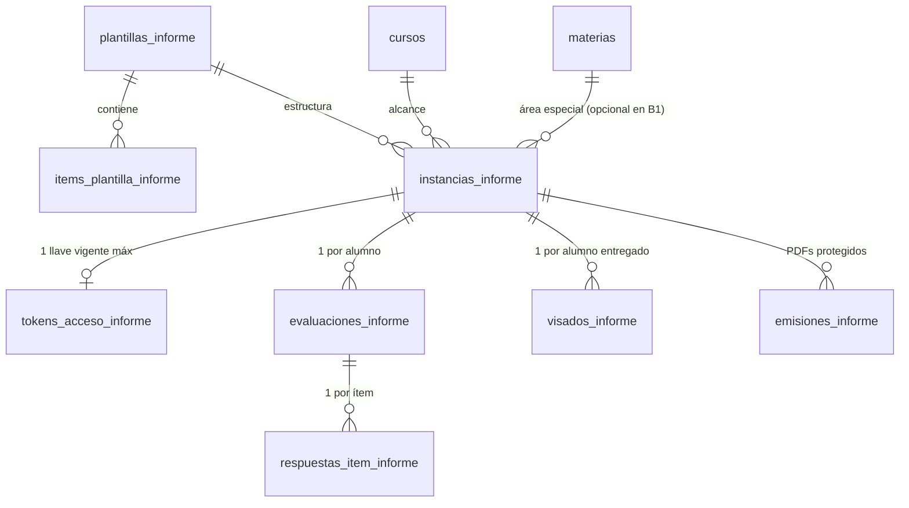

# Plan de Implementación y Especificación Canónica: Informes de Maestras

Actualizado: 19 de octubre de 2026.

## 1. Propósito y Alcance Funcional

El módulo de **Informes de Maestras** gestiona la carga docente, entrega atómica por curso, revisión directiva, visado individual y emisión reactiva de PDFs para las tres instancias anuales de informes pedagógicos y de conducta del nivel primario:

| Instancia (`tipo_informe`) | Responsable de llenado | Cardinalidad por ciclo lectivo | Contenido evaluado | Corte de cursada evaluable |
| --- | --- | --- | --- | --- |
| `CICLO_FINAL` | Maestras de Áreas Especiales | `1 Curso × 1 Materia Especial` (7 × 5 = 35 instancias) | Ítems de desempeño propios de cada `materia + grado` (planos o agrupados en bloques), leyenda opcional de escala y **Desempeño General** al pie. Sin observaciones. | Incluye 4.º bimestre (`bimestre_desde <= 4 && bimestre_hasta >= 4`) |
| `PRIMER_CUATRIMESTRE` | Maestras de Áreas Especiales | `1 Curso × 1 Materia Especial` (7 × 5 = 35 instancias) | 26 ítems fijos de **Conducta** (`SIEMPRE \| A VECES \| NUNCA`) + **Observaciones** en hoja 2. Sin desempeño general. | Incluye 2.º bimestre (`bimestre_desde <= 2 && bimestre_hasta >= 2`) |
| `PRIMER_BIMESTRE` | Maestra de Grado | `1 Curso` (7 instancias, relación 1 a 1 con el grado) | Mismos 26 ítems fijos de **Conducta** (`SIEMPRE \| A VECES \| NUNCA`) + **Observaciones** en hoja 2. Sin desempeño general. | Incluye 1.er bimestre (`bimestre_desde <= 1 && bimestre_hasta >= 1`) |

### Decisiones de Producto y Arquitectura Confirmadas

1. **Estrategia de implementación inversa (de mayor a menor complejidad)**:
   - Se implementa primero **Fase 1 (`CICLO_FINAL`)**, que contempla la cardinalidad compuesta (`curso + materia especial`), plantillas variables por materia y grado, ítems agrupados por bloques, leyendas de escala y calificación de Desempeño General.
   - Luego se implementa **Fase 2 (`PRIMER_CUATRIMESTRE`)**, que reutiliza el tablero y alcance por materia especial pero fija la plantilla en los 26 ítems de conducta con observaciones.
   - Finalmente se implementa **Fase 3 (`PRIMER_BIMESTRE`)**, que reutiliza la misma plantilla de conducta de Fase 2 reduciendo el alcance a 1 informe por grado (`materia_id = null`).
2. **Las 5 Materias Especiales alcanzadas**:
   - *Educación Física*
   - *Artes Visuales*
   - *Lenguas Adicionales: Inglés*
   - *Música*
   - *Tecnología, diseño y programación*
3. **Configuración de plantillas por catálogo/migración**:
   - Los ítems, bloques, escalas de ítems y escalas de Desempeño General se definen en base de datos mediante migraciones versionadas (`plantillas_informe` e `items_plantilla_informe`), sin pantalla constructora en la UI por el momento.
   - En `CICLO_FINAL`, tanto los ítems como la escala de `Desempeño General` varían según la materia especial y el grado/ciclo.
4. **Desempeño General (`CICLO_FINAL`)**:
   - Lo selecciona manualmente la docente como un campo obligatorio dentro del formulario del Informe Final.
5. **Observaciones (`PRIMER_BIMESTRE` y `PRIMER_CUATRIMESTRE`)**:
   - Los Informes Finales **no** llevan cuadro ni hoja de observaciones.
   - Los informes de 1.er Bimestre y 1.er Cuatrimestre incluyen un campo de texto libre opcional `observaciones`, que se imprime en la Hoja 2 como `Observaciones: -` cuando se confirma vacío.
6. **Registro de Nombre y Apellido de la docente**:
   - El pie de página del PDF exige imprimir `NOMBRE` y `APELLIDO` de la maestra en columnas separadas.
   - Ambos campos (`docente_nombre` y `docente_apellido`) se capturan obligatoriamente al emitir el Magic Link (y pueden editarse desde Dirección en la instancia) y quedan persistidos en `instancias_informe`.
   - El bloque derecho de firma (`DIRECCIÓN`) imprime `MYRIAM GRACIELA` (`NOMBRE`) y `ADDUCCI` (`APELLIDO`).
7. **Navegación y Tablero Institucional (`/app/informes`)**:
   - Sección principal propia en el menú lateral de `MainLayout`: **Informes** (`/app/informes`), independiente de `Boletines`.
   - En las instancias de Áreas Especiales (`CICLO_FINAL` y `PRIMER_CUATRIMESTRE`), el tablero permite alternar entre **«Ver por Grado»** (selecciona de 1.° a 7.° y lista sus 5 materias especiales) y **«Ver por Materia Especial»** (selecciona la materia y lista los 7 grados).
8. **Ruta pública docente (`/carga-informe`) y Editor Único**:
   - Los enlaces mágicos de informes utilizan la ruta pública dedicada `/carga-informe`.
   - La carga docente y la revisión directiva comparten un único componente editor (`VistaInformePorAlumno`), diferenciando permisos y origen de datos mediante `InformeAccessPolicy` e `InformeDataSource`.
9. **Elegibilidad y Reactividad del PDF**:
   - Cada informe es documentalmente independiente: para emitir o descargar su PDF sólo se exige que ese informe puntual del alumno esté en estado `VISADO` y que estén completos `nombres` y `apellidos` del alumno y `docente_nombre` y `docente_apellido` de la instancia (sin bloqueos por DNI, tutor único ni visados de otros períodos).
   - La `huella` SHA-256 de la instantánea incluye los datos filiatorios del alumno (`nombres`, `apellidos`), curso, turno, ciclo, materia, nombre y apellido de la docente, respuestas, desempeño general u observaciones y generación de visado. Cualquier cambio invalida la emisión vigente y regenera el PDF al descargarlo o actualizar el lote del curso.

---

## 2. Modelo de Datos en PocketBase (`pb_migrations`)

Todas las colecciones de informes bloquean la escritura directa desde clientes (`createRule: null`, `updateRule: null`, `deleteRule: null`) y operan a través de los gateways transaccionales en `pb_hooks`.

### 2.1. `plantillas_informe`
- `codigo` (`text`, único, ej. `FINAL_ARTES_VISUALES_G2`, `FINAL_ED_FISICA_G2`, `CONDUCTA_ESTANDAR_26`)
- `tipo_informe` (`select`: `'PRIMER_BIMESTRE' | 'PRIMER_CUATRIMESTRE' | 'CICLO_FINAL'`)
- `materia_id` (`relation` -> `materias`, opcional: vacío en `CONDUCTA_ESTANDAR_26`, requerido en `CICLO_FINAL`)
- `grado_desde` (`number`, `1..7`)
- `grado_hasta` (`number`, `1..7`)
- `titulo_tabla` (`text`, ej. `"Contenidos de Artes Visuales"`, `"Logros del Area Educacion Fisica"`, `"CONDUCTAS"`)
- `escala_items` (`json`: arreglo de `{ codigo: string, etiqueta: string, descripcion?: string }`)
- `mostrar_leyenda_escala` (`bool`: `true` cuando el PDF debe renderizar el cuadro superior de referencia `Contenidos`, como en Educación Física)
- `requiere_desempeno_general` (`bool`: `true` en `CICLO_FINAL`, `false` en conducta)
- `escala_desempeno_general` (`json`: arreglo de `{ codigo: string, etiqueta: string }`)
- `permite_observaciones` (`bool`: `false` en `CICLO_FINAL`, `true` en `PRIMER_BIMESTRE` y `PRIMER_CUATRIMESTRE`)

### 2.2. `items_plantilla_informe`
- `plantilla_id` (`relation` -> `plantillas_informe`, `cascadeDelete: true`)
- `bloque_nombre` (`text`, opcional: nombre de la categoría lateral agrupada, ej. `"Desplazamientos"`, `"Rolidos"`, `"Apoyos"`, `"Saltos"`)
- `bloque_orden` (`number`, opcional)
- `orden_visual` (`number`, entero `1..N`)
- `pagina` (`number`, entero `1 | 2`, define en qué hoja del PDF se ubica el ítem cuando la tabla abarca dos páginas)
- `texto` (`text`, consigna o indicador evaluativo)

### 2.3. `instancias_informe`
- `ciclo_id` (`relation` -> `ciclos_lectivos`, requerido)
- `tipo_informe` (`select`: `'PRIMER_BIMESTRE' | 'PRIMER_CUATRIMESTRE' | 'CICLO_FINAL'`, requerido)
- `curso_id` (`relation` -> `cursos`, requerido)
- `materia_id` (`relation` -> `materias`, opcional: requerido en `PRIMER_CUATRIMESTRE` y `CICLO_FINAL`, vacío en `PRIMER_BIMESTRE`)
- `plantilla_id` (`relation` -> `plantillas_informe`, requerido)
- `estado` (`select`: `'BORRADOR_DOCENTE' | 'CONTROL_DIRECTIVO'`, requerido)
- `docente_nombre` (`text`, requerido al emitir enlace)
- `docente_apellido` (`text`, requerido al emitir enlace)
- `revision` (`number`, entero >= 0, control de concurrencia optimista)
- `enviado_at` (`date`, opcional)
- `enviado_por` (`text`, opcional)
- Índice único: `(ciclo_id, tipo_informe, curso_id, materia_id)`.

### 2.4. `tokens_acceso_informe`
- `instancia_id` (`relation` -> `instancias_informe`, índice único: una sola llave vigente por instancia)
- `token` y `token_hash` (`text`, SHA-256 de 64 caracteres hexadecimales, índice único)
- `token_prefijo` (`text`, primeros caracteres para identificación administrativa)
- `token_cifrado` (`text`, copia AES-256-GCM recuperable sólo por sesión institucional autenticada)

### 2.5. `evaluaciones_informe` y `respuestas_item_informe`
- **`evaluaciones_informe`**:
  - `instancia_id` (`relation` -> `instancias_informe`)
  - `inscripcion_id` (`relation` -> `inscripciones`)
  - `desempeno_general_valor` (`text`, opcional/requerido según `plantilla.requiere_desempeno_general`)
  - `observaciones` (`text`, opcional según `plantilla.permite_observaciones`)
  - Índice único: `(instancia_id, inscripcion_id)`.
- **`respuestas_item_informe`**:
  - `evaluacion_informe_id` (`relation` -> `evaluaciones_informe`, `cascadeDelete: true`)
  - `item_id` (`relation` -> `items_plantilla_informe`)
  - `valor_codigo` (`text`, validado contra `plantilla.escala_items`)
  - Índice único: `(evaluacion_informe_id, item_id)`.

### 2.6. `visados_informe` y `emisiones_informe`
- **`visados_informe`**:
  - `instancia_id` (`relation` -> `instancias_informe`)
  - `inscripcion_id` (`relation` -> `inscripciones`)
  - `estado` (`select`: `'PENDIENTE_REVISION' | 'VISADO'`)
  - `revision_contenido` (`number`), `revision_visada` (`number`), `generacion_visado` (`number`), `visado_at` (`date`), `visado_por` (`relation` -> `users`)
  - Índice único: `(instancia_id, inscripcion_id)`.
- **`emisiones_informe`**:
  - `instancia_id`, `inscripcion_id`, `huella`, `version`, `estado` (`'VIGENTE' | 'INVALIDADA'`), `nombre`, `emisor`, `motivo`, `archivo_sha256`, `instantanea` (`json`), `archivo` (`file` protegido `application/pdf`).

---

## 3. Especificación de Plantillas de Referencia Relevadas

### 3.1. Informe Ciclo Final — Artes Visuales (2.° Grado)
- **Encabezado PDF**: `INFORME Especiales | Ciclo Final | <Año>`, sub-etiqueta derecha: `<Nombre Materia>` + `EP`.
- **Título de tabla**: `Contenidos de Artes Visuales`
- **Leyenda superior**: No (`mostrar_leyenda_escala: false`)
- **Escala de ítems (`escala_items`)**:
  1. `NO_ALCANZADO` -> `"No Alcanzado"`
  2. `EN_PROCESO` -> `"En proceso de Alcanzar"`
  3. `ALCANZADO` -> `"Alcanzado"`
- **Ítems calificativos (18 ítems, lista plana en Hoja 1)**:
  1. Relación con la materia.
  2. Relación con el docente.
  3. Relación con los compañeros.
  4. Respeto por las normas de convivencia.
  5. Atención en clase.
  6. Aplicación de contenidos.
  7. Respuesta a pedido de materiales de trabajo.
  8. Respuesta a consignas de trabajo.
  9. Participación en clase.
  10. Incorporación de técnicas nuevas.
  11. Percepción morfológica.
  12. Criterio compositivo.
  13. Estructuración de figura humana.
  14. Investigación en el uso de materiales gráficos.
  15. Investigación en el uso de materiales pictóricos.
  16. Criterio cromático.
  17. Utilización de elementos del lenguaje visual en la bidimensión.
  18. Utilización de elementos del lenguaje visual en la tridimensión.
- **Desempeño General**: Requerido al pie (`E. Primaria Artes Visuales`, ej. `Avanzado`).

### 3.2. Informe Ciclo Final — Educación Física (2.° Grado)
- **Encabezado PDF**: `INFORME Especiales | Ciclo Final | <Año>`, sub-etiqueta derecha: `Educación Física` + `EP`.
- **Leyenda superior (`mostrar_leyenda_escala: true`, cuadro `Contenidos` en Hoja 1)**:
  - `A`: `"No se trabajó el contenido durante el año"`
  - `B`: `"Aun le esta costando trabajo el contenido durante este año"`
  - `C`: `"Se ven claros avances en la adquisición del contenido propuesto"`
  - `D`: `"Lo logra con soltura y seguridad"`
- **Título de tabla**: `Logros del Area Educacion Fisica` (columnas `A | B | C | D`)
- **Ítems calificativos (24 ítems agrupados en 4 bloques a lo largo de 2 hojas, con encabezado y pie de firmas en ambas hojas)**:
  - **Hoja 1 — Bloque 1: `Desplazamientos`** (4 ítems):
    1. Desplazamientos en el espacio, combinando diferentes tiempos y ritmos.
    2. Ajustados a las acciones de los compañeros.
    3. Enlazando diferentes formas y direcciones del desplazamiento.
    4. Ajustado a los espacios de juego, el objeto y los compañeros.
  - **Hoja 1 — Bloque 2: `Rolidos`** (6 ítems):
    5. Rolidos laterales en plano horizontal.
    6. Rol adelante desde cuclillas.
    7. Rol adelante desde pies firmes.
    8. Rol adelante con variantes de salida.
    9. Rol atrás con ayuda.
    10. Rol atrás sin asistencia.
  - **Hoja 2 — Bloque 3: `Apoyos`** (7 ítems):
    11. Cuadripeia
    12. Tripedia
    13. Conejito
    14. Potrillito
    15. Vertical con ayuda
    16. Vertical sin ayuda
    17. Media Luna
  - **Hoja 2 — Bloque 4: `Saltos`** (7 ítems):
    18. Saltos bipodales
    19. Saltos unipodales
    20. Saltos en busca de longitud
    21. Saltos en busca de altura
    22. Variabilidad de saltos gimnásticos
    23. Saltos ajustados a un objeto fijo
    24. Con impulso de un elemento externo
- **Desempeño General**: Requerido al pie de la Hoja 2 (`E. Primaria Educación Física`, ej. `Alcanzado`).

### 3.3. Informe de Conducta Estándar (`CONDUCTA_ESTANDAR_26` — 1.er Bimestre y 1.er Cuatrimestre)
- **Encabezado PDF**:
  - En 1.er Bimestre: `INFORME Maestras | Primer Bimestre | Ciclo: <Año>`, etiqueta derecha: `Maestras`.
  - En 1.er Cuatrimestre: `INFORME Maestras | Primer Cuatrimestre | Ciclo: <Año>`, etiqueta derecha: nombre de la materia especial (ej. `Lenguas Adicionales Inglés`).
- **Título de tabla**: `CONDUCTAS`
- **Escala de ítems**: `SIEMPRE` | `A VECES` | `NUNCA`
- **Ítems calificativos (26 preguntas fijas en Hoja 1)**:
  1. ¿Se relaciona adecuadamente con su situación de alumno?
  2. ¿Tiene buena predisposición para la actividad diaria?
  3. ¿Presenta dificultades para comprender las consignas?
  4. ¿Se relaciona adecuadamente con sus compañeros?
  5. ¿Respeta al docente como modelo de autoridad?
  6. ¿Se dirige con respeto a sus maestros?
  7. ¿Respeta los límites puestos por el docente?
  8. ¿Respeta normas de convivencia?
  9. ¿Respeta a sus compañeros?
  10. ¿Manifiesta agresión verbal?
  11. ¿Manifiesta agresión física?
  12. ¿Respeta el espacio del otro?
  13. ¿Respeta las diferencias?
  14. ¿Es tolerante con el tiempo del otro?
  15. ¿Establece relaciones con la totalidad de sus compañeros?
  16. ¿Descalifica en alguna forma a alguno de sus compañeros?
  17. ¿Acepta pautas de juego propuestas por otros pares?
  18. ¿Acepta normas institucionales?
  19. ¿Tiene iniciativa para dar respuestas y participar en clase?
  20. ¿Presta atención en clase?
  21. ¿Trabaja en clase?
  22. ¿Presenta resistencia para trabajar?
  23. ¿Dispersa al grupo?
  24. ¿Se deja dispersar por otros compañeros?
  25. ¿Habla cuando la maestra está explicando?
  26. ¿Conversa con sus compañeros en momentos de trabajar?
- **Hoja 2**: `Observaciones: <texto o "-">`.

---

## 4. Hoja de Ruta Granular por Etapas

### Fase 1: Informes Finales (`CICLO_FINAL` — Áreas Especiales)

#### Paso 1.1: Migración de Esquema y Seed Inicial de Plantillas
1. Crear migración en `pb_migrations` con las colecciones `plantillas_informe`, `items_plantilla_informe`, `instancias_informe`, `tokens_acceso_informe`, `evaluaciones_informe`, `respuestas_item_informe`, `visados_informe` y `emisiones_informe`.
2. Poblar en la migración las plantillas de `CICLO_FINAL` relevadas (*Artes Visuales* y *Educación Física*) y plantillas iniciales para *Inglés*, *Música* y *Tecnología*, junto con la plantilla `CONDUCTA_ESTANDAR_26`.
3. Actualizar `pb_schema.json` y validar contra PocketBase local.

#### Paso 1.2: Gateways HTTP en `pb_hooks` (Enlaces, Docente y Directivo)
1. Implementar `/api/cys/enlaces-informes` (emisión con captura de `docenteNombre` y `docenteApellido`, rotación, recuperación AES-256-GCM y baja).
2. Implementar `/api/cys/docente-informes/*` (`GET /contexto`, `GET /alumnos/:inscripcionId`, `PUT /alumnos/:inscripcionId`, `POST /enviar` con verificación de cursadas pendientes y completitud de todos los ítems + Desempeño General).
3. Implementar `/api/cys/directivo/informes/*` (`GET /etapas/:cicloId/:tipoInforme`, `GET /revision/:instanciaId`, `POST /sincronizar-matricula`, `PATCH /docente`, `GET/PUT /alumnos/:inscripcionId` con concurrencia `expectedRevision`, y `POST /visar` / `POST /retirar-visado`).
4. Crear suite automatizada de pruebas HTTP (`test-informes-workflow-http.cjs`) para validar el contrato completo.

#### Paso 1.3: Módulo Frontend `/app/informes` y Ruta Docente `/carga-informe`
1. Incorporar `/app/informes` en `MainLayout` y `/carga-informe` en el router público.
2. Construir el tablero operativo de Informes con selector de instancia (`Ciclo Final`, `Primer Cuatrimestre`, `Primer Bimestre`) y vista conmutable **Por Grado** / **Por Materia Especial**.
3. Construir el modal de gestión de Magic Links con ingreso y edición de `Nombre` y `Apellido` de la docente.
4. Construir el editor único `VistaInformePorAlumno` con `InformeAccessPolicy` e `InformeDataSource`, soportando bloques agrupados, lista plana, leyenda de escala, Desempeño General y revisión directiva con edición atómica, visado e indicadores en tiempo real.

#### Paso 1.4: Plantilla Documental A4 y Emisión Reactiva de PDFs (`CICLO_FINAL`)
1. Implementar el endpoint de instantánea `GET /api/cys/directivo/informes/:instanciaId/alumnos/:inscripcionId/instantanea` y las rutas de almacenamiento/descarga de `emisiones_informe`, incluyendo invalidación reactiva por `huella` ante cambios en respuestas, datos de la docente o nombre/apellido del alumno.
2. Construir los componentes React/CSS de impresión A4 para `INFORME Especiales - Ciclo Final` (1 y 2 páginas, con tira ilustrada lateral, leyenda opcional, tabla plana o con `rowSpan` por bloques, bloque de Desempeño General y pie de firmas en cada página).
3. Conectar la descarga individual y el modal de lote ZIP del curso con el worker de PDF en desarrollo y producción.

#### Paso 1.5: Completitud del Catálogo de Plantillas de Ciclo Final
1. Incorporar mediante migración las grillas definitivas de ítems, bloques y escalas de los restantes grados/materias especiales de `CICLO_FINAL` a medida que sean suministradas.

---

### Fase 2: Informes de 1.er Cuatrimestre (`PRIMER_CUATRIMESTRE` — Áreas Especiales)
1. Habilitar en el gateway y en el tablero la instancia `PRIMER_CUATRIMESTRE` vinculada a la plantilla `CONDUCTA_ESTANDAR_26` para las 5 materias especiales en los 7 grados (corte evaluable: 2.º bimestre).
2. Activar en `VistaInformePorAlumno` la sección de `Observaciones` cuando `plantilla.permite_observaciones === true`.
3. Incorporar la variante visual de la plantilla PDF `INFORME Maestras - Primer Cuatrimestre` (Hoja 1: tabla de 26 conductas + firmas; Hoja 2: `Observaciones: <texto o "-">`).

---

### Fase 3: Informes de 1.er Bimestre (`PRIMER_BIMESTRE` — Maestras de Grado)
1. Habilitar la instancia `PRIMER_BIMESTRE` con alcance `1 Curso` (`materia_id = null`, 7 instancias por ciclo lectivo, corte evaluable: 1.er bimestre).
2. Adaptar la vista del tablero en `PRIMER_BIMESTRE` para mostrar directamente la tabla de los 7 grados (sin selector de materia especial) y renderizar el encabezado PDF `INFORME Maestras - Primer Bimestre` con etiqueta `Maestras`.
