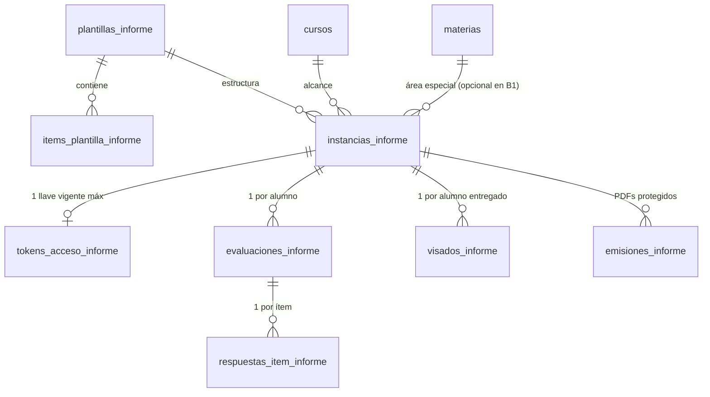

# Plan de Implementación y Especificación Canónica: Informes de Maestras

Actualizado: 20 de octubre de 2026.

## 1. Propósito y Alcance Funcional

El módulo de **Informes de Maestras** gestiona la carga docente, entrega atómica por curso, revisión directiva, visado individual y emisión reactiva de PDFs para las tres instancias anuales de informes pedagógicos y de conducta del nivel primario:

| Instancia (`tipo_informe`) | Responsable de llenado | Cardinalidad por ciclo lectivo | Contenido evaluado | Corte de cursada evaluable |
| --- | --- | --- | --- | --- |
| `CICLO_FINAL` | Maestras de Áreas Especiales | `1 Curso × 1 Materia Especial` (7 × 5 = 35 instancias) | Ítems de desempeño propios de cada área especial (planos o agrupados en bloques), leyenda opcional de escala, **Desempeño General** obligatorio al pie (según escala de 1.er o 2.° Ciclo) y campo opcional de **Observaciones / devolución** de libre escritura. | Incluye 4.º bimestre (`bimestre_desde <= 4 && bimestre_hasta >= 4`) |
| `PRIMER_CUATRIMESTRE` | Maestras de Áreas Especiales | `1 Curso × 1 Materia Especial` (7 × 5 = 35 instancias) | 26 ítems fijos de **Conducta** (`SIEMPRE \| A VECES \| NUNCA`) + **Observaciones** en hoja 2. Sin desempeño general. | Incluye 2.º bimestre (`bimestre_desde <= 2 && bimestre_hasta >= 2`) |
| `PRIMER_BIMESTRE` | Maestra de Grado | `1 Curso` (7 instancias, relación 1 a 1 con el grado) | Mismos 26 ítems fijos de **Conducta** (`SIEMPRE \| A VECES \| NUNCA`) + **Observaciones** en hoja 2. Sin desempeño general. | Incluye 1.er bimestre (`bimestre_desde <= 1 && bimestre_hasta >= 1`) |

### Decisiones de Producto y Arquitectura Confirmadas

1. **Estrategia de implementación inversa (de mayor a menor complejidad)**:
   - Se implementa primero **Fase 1 (`CICLO_FINAL`)**, que contempla la cardinalidad compuesta (`curso + materia especial`), plantillas por materia y bloque de grados, ítems agrupados por bloques, leyendas de escala y calificación de Desempeño General.
   - Luego se implementa **Fase 2 (`PRIMER_CUATRIMESTRE`)**, que reutiliza el tablero y alcance por materia especial pero fija la plantilla en los 26 ítems de conducta con observaciones.
   - Finalmente se implementa **Fase 3 (`PRIMER_BIMESTRE`)**, que reutiliza la misma plantilla de conducta de Fase 2 reduciendo el alcance a 1 informe por grado (`materia_id = null`).
2. **Las 5 Materias Especiales alcanzadas y su distribución por grados en `CICLO_FINAL`**:
   - **Educación Física** es la única materia especial con distinción de consignas por grados, dividida en **3 bloques**:
     - `1.°, 2.° y 3.er grado` (`FINAL_ED_FISICA_G2`, 24 ítems en 4 bloques y 2 hojas).
     - `4.° y 5.° grado` (`FINAL_ED_FISICA_G4_5`, 20 ítems en 4 bloques y 2 hojas).
     - `6.° y 7.° grado` (`FINAL_ED_FISICA_G6_7`, 22 ítems en 4 bloques y 2 hojas).
   - **El resto de las materias especiales mantienen las mismas consignas para los 7 grados (`1.° a 7.°`)**:
     - *Artes Visuales* (`FINAL_ARTES_VISUALES_G2`, 18 ítems).
     - *Lenguas Adicionales: Inglés* (`FINAL_INGLES_BASE`, 18 ítems).
     - *Educación Musical* (`FINAL_MUSICA_BASE`, 19 ítems).
     - *Tecnología, diseño y programación* (`FINAL_TECNOLOGIA_BASE`, 17 ítems).
3. **Configuración de plantillas por catálogo/migración**:
   - Los ítems, bloques, escalas de ítems y escalas de Desempeño General se definen en base de datos mediante migraciones versionadas (`plantillas_informe` e `items_plantilla_informe`), sin pantalla constructora en la UI.
4. **Desempeño General (`CICLO_FINAL`) según Ciclo**:
   - Lo selecciona manualmente la docente como campo obligatorio del Informe Final y utiliza la misma escala del Boletín según el ciclo del grado:
     - **1.er Ciclo (1.° a 3.er grado)**: conceptual (`No Alcanzó los objetivos`, `En proceso`, `Alcanzado`, `Avanzado`, `Destacado`, `No corresponde`).
     - **2.° Ciclo (4.° a 7.° grado)**: alfanumérica (`No Alcanzó Los Objetivos 1..3`, `En Proceso 4..5`, `Alcanzado 6..7`, `Avanzado 8..9`, `Destacado 10`, `No Corresponde`).
5. **Observaciones / Devoluciones**:
   - En `CICLO_FINAL`, las docentes (y el equipo directivo durante el visado) disponen de un campo opcional de libre escritura (`observaciones`) para consignar devoluciones o leyendas de respaldo PPI; sólo se imprime debajo del recuadro de `Desempeño General` cuando contiene texto.
   - En `PRIMER_BIMESTRE` y `PRIMER_CUATRIMESTRE`, `observaciones` se imprime en la Hoja 2 como `Observaciones: <texto>` o `Observaciones: -` cuando queda vacío.
6. **Registro de Nombre y Apellido de la docente**:
   - El pie de página del PDF exige imprimir `NOMBRE` y `APELLIDO` de la maestra en columnas separadas.
   - Ambos campos (`docente_nombre` y `docente_apellido`) se capturan obligatoriamente al emitir el Magic Link (y pueden editarse desde Dirección en la instancia) y quedan persistidos en `instancias_informe`.
   - El bloque derecho de firma (`DIRECCIÓN`) imprime `MYRIAM GRACIELA` (`NOMBRE`) y `ADDUCCI` (`APELLIDO`).
7. **Navegación y Tablero Institucional (`/app/informes`)**:
   - Sección principal propia en el menú lateral de `MainLayout`: **Informes** (`/app/informes`), independiente de `Boletines`.
   - En las instancias de Áreas Especiales (`CICLO_FINAL` y `PRIMER_CUATRIMESTRE`), el tablero permite alternar entre **«Ver por Grado»** (selecciona de 1.° a 7.° y lista sus 5 materias especiales) y **«Ver por Materia Especial»** (selecciona la materia y lista los 7 grados).
8. **Ruta pública docente (`/carga-informe`) y Editor Único**:
   - Los enlaces mágicos de informes utilizan la ruta pública dedicada `/carga-informe`.
   - La carga docente y la revisión directiva comparten un único componente editor (`VistaInformePorAlumno`), diferenciando permisos y origen de datos mediante `InformeAccessPolicy` e `InformeDataSource`.
9. **Elegibilidad y Reactividad del PDF**:
   - Cada informe es documentalmente independiente: para emitir o descargar su PDF sólo se exige que ese informe puntual del alumno esté en estado `VISADO` y que estén completos `nombres` y `apellidos` del alumno y `docente_nombre` y `docente_apellido` de la instancia (sin bloqueos por DNI, tutor único ni visados de otros períodos).
   - La `huella` SHA-256 de la instantánea incluye los datos filiatorios del alumno (`nombres`, `apellidos`), curso, turno, ciclo, materia, nombre y apellido de la docente, respuestas, desempeño general, observaciones y generación de visado. Cualquier cambio invalida la emisión vigente y regenera el PDF al descargarlo o actualizar el lote del curso.

---

## 2. Modelo de Datos en PocketBase (`pb_migrations`)

Todas las colecciones de informes bloquean la escritura directa desde clientes (`createRule: null`, `updateRule: null`, `deleteRule: null`) y operan a través de los gateways transaccionales en `pb_hooks`.

---

## 3. Catálogo Oficial de Plantillas

### 3.1. Informe Ciclo Final — Artes Visuales (`FINAL_ARTES_VISUALES_G2`, 1.° a 7.° Grado)
- **Título de tabla**: `Contenidos de Artes Visuales` (`No Alcanzado | En proceso de Alcanzar | Alcanzado`)
- **Ítems calificativos (18 ítems, lista plana en Hoja 1)**:
  1. Relación con la materia.
  2. Relación con el docente.
  3. Relación con los compañeros.
  4. Respeto por las normas de convivencia.
  5. Atención en clase.
  6. Aplicación de contenidos.
  7. Respuesta a pedido de materiales de trabajo.
  8. Respuesta a consignas de trabajo.
  9. Participación en clase.
  10. Incorporación de técnicas nuevas.
  11. Percepción morfológica.
  12. Criterio compositivo.
  13. Estructuración de figura humana.
  14. Investigación en el uso de materiales gráficos.
  15. Investigación en el uso de materiales pictóricos.
  16. Criterio cromático.
  17. Utilización de elementos del lenguaje visual en la bidimensión.
  18. Utilización de elementos del lenguaje visual en la tridimensión.

### 3.2. Informe Ciclo Final — Inglés (`FINAL_INGLES_BASE`, 1.° a 7.° Grado)
- **Título de tabla**: `Contenidos de Inglés` (`No Alcanzado | En proceso de Alcanzar | Alcanzado`)
- **Ítems calificativos (18 ítems, lista plana en Hoja 1)**:
  1. Demuestra interés por el aprendizaje de la lengua extranjera
  2. Manejo de estructuras sencillas en Inglés.
  3. Comprensión de estructuras sencillas de salutación y cortesía.
  4. Progreso en el desarrollo de la atención y de la observación del idioma durante el transcurso de la clase.
  5. Mantiene buena relación con la docente.
  5. Mantiene buena relación con sus pares.
  7. Atención en clase.
  8. Participación en clase.
  9. Cumple con los materiales para la materia.
  10. Se expresa oralmente en inglés con coherencia.
  11. Su pronunciación es clara.
  12. Respeta los turnos del habla de sus pares y escucha a los mismos
  13. Utiliza el idioma inglés para narrar, describir y/o pedir.
  14. Interpreta mensajes orales.
  15. Adecua sus respuestas orales y escritas al contexto.
  16. Progresa en escritura.
  17. Incorpora nuevo vocabulario.
  18. Comprende consignas de trabajo o narraciones en inglés.

### 3.3. Informe Ciclo Final — Educación Musical (`FINAL_MUSICA_BASE`, 1.° a 7.° Grado)
- **Título de tabla**: `Contenidos de Educación Musical` (`No Alcanzado | En proceso de Alcanzar | Alcanzado`)
- **Ítems calificativos (19 ítems, lista plana en Hoja 1)**:
  1. Demuestra interés por el aprendizaje de la materia.
  2. Mantiene buena relación con la docente
  3. Mantiene buena relación con sus pares
  4. Atención en clase
  5. Participa activamente de la clase
  6. Cumple con los materiales
  7. Entona el canto
  8. Identifica los instrumentos musicales según su familia
  9. Es correcto en la ejecución rítmica
  10. Es correcto en la ejecución melódica
  11. Lee grafías pertenecientes al lenguaje musical
  12. Cuida los instrumentos musicales
  13. Ejecuta correctamente los instrumentos musicales
  14. Realiza interpretaciones a dos o más voces
  15. Se interesa por la vida y la música de diferentes compositores
  16. Muestra interés por distintos estilos musicales
  17. Tiene una audición activa de acuerdo a su edad
  18. Distingue y/o ejecuta diferentes parámetros de sonido
  19. Realiza y se interesa por el registro grabado de las producciones musicales

### 3.4. Informe Ciclo Final — Tecnología (`FINAL_TECNOLOGIA_BASE`, 1.° a 7.° Grado)
- **Título de tabla**: `Contenidos de Tecnología` (`No Alcanzado | En proceso de Alcanzar | Alcanzado`)
- **Ítems calificativos (17 ítems, lista plana en Hoja 1)**:
  1. Relación con la materia.
  2. Relación con el docente.
  3. Relación con los compañeros.
  4. Respeto por las normas de convivencia.
  5. Atención en clase.
  6. Aplicación de contenidos.
  7. Respuesta a pedido de materiales de trabajo.
  8. Respuesta a consignas de trabajo.
  9. Comprensión básica del sentido y área de la materia.
  10. Comprensión de las fases del proceso.
  11. Cumplimiento con entregas en tiempo y forma.
  12. Participación en clase.
  13. Participación en trabajos grupales.
  14. Proyección de lo aprendido a otras aplicaciones relacionadas.
  15. Manejo adecuado de herramientas.
  16. Puede integrar partes para formar un todo.
  17. Reflexión sobre procesos tecnológicos y uso de la IA (Inteligencia Artificial).

### 3.5. Informe Ciclo Final — Educación Física (3 bloques de grados)
- **Leyenda superior (`mostrar_leyenda_escala: true`, cuadro `Contenidos` en Hoja 1)**:
  - `A`: `"No se trabajó el contenido durante el año"`
  - `B`: `"Aun le esta costando trabajo el contenido durante este año"`
  - `C`: `"Se ven claros avances en la adquisición del contenido propuesto"`
  - `D`: `"Lo logra con soltura y seguridad"`
- **Título de tabla**: `Logros del Area Educacion Fisica` (columnas `A | B | C | D`)
- **Bloques en las 3 plantillas**: Hoja 1 (`Desplazamientos`, `Rolidos`); Hoja 2 (`Apoyos`, `Saltos`).
  1. **1.°, 2.° y 3.er Grado (`FINAL_ED_FISICA_G2`, 24 ítems)**:
     - `Desplazamientos` (4), `Rolidos` (6), `Apoyos` (7), `Saltos` (7).
  2. **4.° y 5.° Grado (`FINAL_ED_FISICA_G4_5`, 20 ítems)**:
     - `Desplazamientos` (4): ajustados a un objeto móvil; ajustados al objeto móvil y la acción del compañero; ajustados a los tiempos musicales; con manipulación de objetos.
     - `Rolidos` (5): laterales; adelante con variantes de salida; desde diferentes entradas; atrás en plano horizontal; atrás con impulso de brazos.
     - `Apoyos` (6): Tripedias; Potrillito; Vertical con ayuda; Vertical sin ayuda; Media luna; Media luna con carrera previa.
     - `Saltos` (5): unipodales y bipodales; enlazados en cadena motora; ajustados a un objeto móvil; variabilidad de saltos gimnásticos; con tabla de pique o minitramp.
  3. **6.° y 7.° Grado (`FINAL_ED_FISICA_G6_7`, 22 ítems)**:
     - `Desplazamientos` (4): con cambios de ritmo y dirección; ajustados a la acción del compañero, el objeto y el espacio; con manipulación de objetos; ajustados a la acción del compañero y los tiempos musicales.
     - `Rolidos` (5): adelante; con variantes de entrada y salida; volado; atrás sin ayuda; atrás con impulso de brazos.
     - `Apoyos` (6): Potrillito; Vertical; Medialuna; Medialuna con carrera previa; Rondo; Mortero.
     - `Saltos` (7): cadenas motoras de saltos enlazados; variabilidad de saltos gimnásticos; en longitud; ajustados a un objeto móvil; con impulso de un elemento; variabilidad de saltos con tabla de pique o minitramp; utilizando el cajón.

### 3.6. Informe de Conducta Estándar (`CONDUCTA_ESTANDAR_26` — 1.er Bimestre y 1.er Cuatrimestre)
- **Título de tabla**: `CONDUCTAS` (`SIEMPRE | A VECES | NUNCA`, 26 preguntas fijas en Hoja 1 + `Observaciones` en Hoja 2).

---

## 4. Hoja de Ruta Granular por Etapas

### Fase 1: Informes Finales (`CICLO_FINAL` — Áreas Especiales) (Completada — 20 de octubre de 2026)

#### Paso 1.1: Migración de Esquema y Seed Inicial de Plantillas (Completado — 19 de octubre de 2026)
1. Migración creada en `pb_migrations/1792440000_created_teacher_reports_collections_and_seed.js` con las 8 colecciones (`plantillas_informe`, `items_plantilla_informe`, `instancias_informe`, `tokens_acceso_informe`, `evaluaciones_informe`, `respuestas_item_informe`, `visados_informe` y `emisiones_informe`), índices únicos y bloqueo total de escrituras directas (`createRule: null`, `updateRule: null`, `deleteRule: null`).

#### Paso 1.2: Gateways HTTP en `pb_hooks` (Enlaces, Docente y Directivo) (Completado — 19 de octubre de 2026)
1. Implementados `pb_hooks/lib/teacherReports.js` y `pb_hooks/teacher_reports.pb.js`, registrados en `deploy/publish-pocketbase.ps1` y `deploy/apply-pocketbase-workflow.sh`, e integrados con la sincronización e invalidación por cambios de cursada en `pb_hooks/lib/teacherAccess.js`.

#### Paso 1.3: Módulo Frontend `/app/informes` y Ruta Docente `/carga-informe` (Completado — 20 de octubre de 2026)
1. Incorporados `/app/informes` en `MainLayout` y `App.tsx`, y `/carga-informe` (`CargaInformePublicaPage`) en el router público.
2. Construido el módulo vertical `src/modules/informes` con selector de instancia, tablero conmutable **«Ver por Grado»** / **«Ver por Materia Especial»**, modales de enlaces y docente, editor único compartido `VistaInformePorAlumno` y revisión institucional `RevisionInformePage`.

#### Paso 1.4: Plantilla Documental A4 y Emisión Reactiva de PDFs (`CICLO_FINAL`) (Completado — 20 de octubre de 2026)
1. Implementados los endpoints `GET /api/cys/directivo/informes/:instanciaId/alumnos/:inscripcionId/instantanea`, `GET/POST /api/cys/directivo/informes/:instanciaId/alumnos/:inscripcionId/emisiones` y `GET /api/cys/directivo/emisiones-informe/:emisionId/archivo`, junto con el hook de invalidación reactiva ante cambios en `alumnos` y verificación transaccional de `huella`.
2. Construido el esqueleto documental A4 (`informe-render.html`, `src/modules/informes/documentos/InformeDocument.tsx` e `InformeDocument.module.css`) con soporte de 1 y 2 páginas, leyenda opcional `Contenidos`, tabla plana o con `rowSpan` por bloques, recuadro de `Desempeño General` con nota libre de observaciones al pie y tabla de firmas (`MAESTRA` y `DIRECCIÓN: MYRIAM GRACIELA ADDUCCI`) en cada hoja.
3. Conectada la descarga individual (`DownloadInformeButton`) y el lote ZIP del curso (`BatchInformeModal`) con el worker de PDF (`scripts/local-pdf-plugin.ts` y `scripts/build-pdf-worker.mjs`).

#### Paso 1.5: Completitud del Catálogo de Plantillas de Ciclo Final (Completado — 20 de octubre de 2026)
1. Incorporadas mediante migración (`pb_migrations/1792440100_updated_teacher_reports_templates_catalog.js`) las grillas oficiales definitivas de las 5 materias especiales de `CICLO_FINAL`: los 3 bloques de grados de Educación Física (`1-3`, `4-5`, `6-7`), las grillas unificadas `1-7` de Artes Visuales, Inglés, Educación Musical y Tecnología, la resolución automática de la escala de `Desempeño General` según 1.er o 2.° Ciclo y el campo opcional de libre escritura `observaciones`.

> [!IMPORTANT]
> **Hito actual (20 de octubre de 2026 — Etapa de Pruebas y Feedback sobre Fase 1)**:
> Toda la **Fase 1 (`CICLO_FINAL`)** se encuentra implementada y verificada en el worktree `teacher_reports_phase1_migration`. Se realiza un alto deliberado antes de iniciar las Fases 2 y 3 para ejecutar pruebas graduales sobre los Informes Finales (tablero por grado/materia, enlaces mágicos, carga docente, revisión directiva, visado y esqueleto PDF A4), recoger feedback operativo y aplicar los ajustes resultantes como base para las siguientes fases.

---

### Fase 2: Informes de 1.er Cuatrimestre (`PRIMER_CUATRIMESTRE` — Áreas Especiales) (Pendiente tras feedback de Fase 1)
1. Habilitar y verificar de extremo a extremo la instancia `PRIMER_CUATRIMESTRE` vinculada a la plantilla `CONDUCTA_ESTANDAR_26` para las 5 materias especiales en los 7 grados (corte evaluable: 2.º bimestre).
2. Ajustar la variante visual de la plantilla PDF `INFORME Maestras - Primer Cuatrimestre` (Hoja 1: tabla de 26 conductas + firmas; Hoja 2: `Observaciones: <texto o "-">`) según el modelo oficial.

---

### Fase 3: Informes de 1.er Bimestre (`PRIMER_BIMESTRE` — Maestras de Grado)
1. Habilitar y verificar de extremo a extremo la instancia `PRIMER_BIMESTRE` con alcance `1 Curso` (`materia_id = null`, 7 instancias por ciclo lectivo, corte evaluable: 1.er bimestre).
2. Ajustar la variante visual del encabezado PDF `INFORME Maestras - Primer Bimestre` con etiqueta `Maestras` según el modelo oficial.
