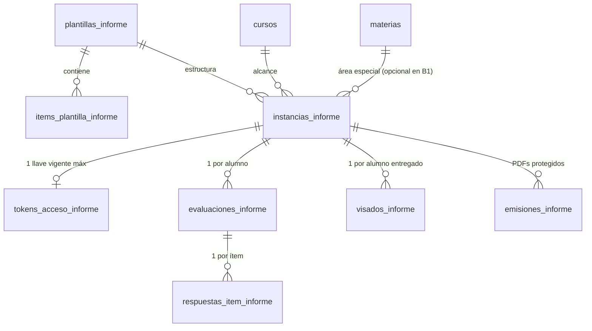

# Plan de Implementación y Especificación Canónica: Informes de Maestras

Actualizado: 20 de octubre de 2026.

## 1. Propósito y Alcance Funcional

El módulo de **Informes de Maestras** gestiona la carga docente, entrega atómica por curso, revisión directiva, visado individual y emisión reactiva de PDFs para las tres instancias anuales de informes pedagógicos y de conducta del nivel primario:

| Instancia (`tipo_informe`) | Responsable de llenado | Cardinalidad por ciclo lectivo | Contenido evaluado | Corte de cursada evaluable |
| --- | --- | --- | --- | --- |
| `CICLO_FINAL` | Maestras de Áreas Especiales | `1 Curso × 1 Materia Especial` (7 × 5 = 35 instancias) | Ítems de desempeño propios de cada área especial (planos o agrupados en bloques), leyenda opcional de escala, **Desempeño General** obligatorio al pie (según escala de 1.er o 2.° Ciclo) y campo opcional de **Observaciones / devolución** de libre escritura. | Incluye 4.º bimestre (`bimestre_desde <= 4 && bimestre_hasta >= 4`) |
| `PRIMER_CUATRIMESTRE` | Maestras de Áreas Especiales | `1 Curso × 1 Materia Especial` (7 × 5 = 35 instancias) | 26 ítems fijos de **Conducta** (`SIEMPRE \| A VECES \| NUNCA`) + **Observaciones** en hoja 2. Sin desempeño general. | Incluye 2.º bimestre (`bimestre_desde <= 2 && bimestre_hasta >= 2`) |
| `PRIMER_BIMESTRE` | Maestra de Grado | `1 Curso` (7 instancias, relación 1 a 1 con el grado) | Mismos 26 ítems fijos de **Conducta** (`SIEMPRE \| A VECES \| NUNCA`) + **Observaciones** en hoja 2. Sin desempeño general. | Incluye 1.er bimestre (`bimestre_desde <= 1 && bimestre_hasta >= 1`) |

### Decisiones de Producto y Arquitectura Confirmadas

1. **Estrategia de implementación inversa (de mayor a menor complejidad)**:
   - Se implementa primero **Fase 1 (`CICLO_FINAL`)**, que contempla la cardinalidad compuesta (`curso + materia especial`), plantillas por materia y bloque de grados, ítems agrupados por bloques, leyendas de escala y calificación de Desempeño General.
   - Luego se implementa **Fase 2 (`PRIMER_CUATRIMESTRE`)**, que reutiliza el tablero y alcance por materia especial pero fija la plantilla en los 26 ítems de conducta con observaciones.
   - Finalmente se implementa **Fase 3 (`PRIMER_BIMESTRE`)**, que reutiliza la misma plantilla de conducta de Fase 2 reduciendo el alcance a 1 informe por grado (`materia_id = null`).
2. **Las 5 Materias Especiales alcanzadas y su distribución por grados en `CICLO_FINAL`**:
   - **Educación Física** es la única materia especial con distinción de consignas por grados, dividida en **3 bloques**:
     - `1.°, 2.° y 3.er grado` (`FINAL_ED_FISICA_G2`, 24 ítems en 4 bloques y 2 hojas).
     - `4.° y 5.° grado` (`FINAL_ED_FISICA_G4_5`, 20 ítems en 4 bloques y 2 hojas).
     - `6.° y 7.° grado` (`FINAL_ED_FISICA_G6_7`, 22 ítems en 4 bloques y 2 hojas).
   - **El resto de las materias especiales mantienen las mismas consignas para los 7 grados (`1.° a 7.°`)**:
     - *Artes Visuales* (`FINAL_ARTES_VISUALES_G2`, 18 ítems).
     - *Lenguas Adicionales: Inglés* (`FINAL_INGLES_BASE`, 18 ítems).
     - *Educación Musical* (`FINAL_MUSICA_BASE`, 19 ítems).
     - *Tecnología, diseño y programación* (`FINAL_TECNOLOGIA_BASE`, 17 ítems).
3. **Configuración de plantillas por catálogo/migración**:
   - Los ítems, bloques, escalas de ítems y escalas de Desempeño General se definen en base de datos mediante migraciones versionadas (`plantillas_informe` e `items_plantilla_informe`), sin pantalla constructora en la UI.
4. **Desempeño General (`CICLO_FINAL`) según Ciclo**:
   - Lo selecciona manualmente la docente como campo obligatorio del Informe Final y utiliza la misma escala del Boletín según el ciclo del grado:
     - **1.er Ciclo (1.° a 3.er grado)**: conceptual (`No Alcanzó los objetivos`, `En proceso`, `Alcanzado`, `Avanzado`, `Destacado`, `No corresponde`).
     - **2.° Ciclo (4.° a 7.° grado)**: alfanumérica (`No Alcanzó Los Objetivos 1..3`, `En Proceso 4..5`, `Alcanzado 6..7`, `Avanzado 8..9`, `Destacado 10`, `No Corresponde`).
5. **Observaciones / Devoluciones**:
   - En `CICLO_FINAL`, las docentes (y el equipo directivo durante el visado) disponen de un campo opcional de libre escritura (`observaciones`) para consignar devoluciones o leyendas de respaldo PPI; sólo se imprime debajo del recuadro de `Desempeño General` cuando contiene texto.
   - En `PRIMER_BIMESTRE` y `PRIMER_CUATRIMESTRE`, `observaciones` se imprime en la Hoja 2 como `Observaciones: <texto>` o `Observaciones: -` cuando queda vacío.
6. **Registro de Nombre y Apellido de la docente**:
   - El pie de página del PDF exige imprimir `NOMBRE` y `APELLIDO` de la maestra en columnas separadas.
   - Ambos campos (`docente_nombre` y `docente_apellido`) se capturan obligatoriamente al emitir el Magic Link (y pueden editarse desde Dirección en la instancia) y quedan persistidos en `instancias_informe`.
   - El bloque derecho de firma (`DIRECCIÓN`) imprime `MYRIAM GRACIELA` (`NOMBRE`) y `ADDUCCI` (`APELLIDO`).
7. **Navegación y Tablero Institucional (`/app/informes`)**:
   - Sección principal propia en el menú lateral de `MainLayout`: **Informes** (`/app/informes`), independiente de `Boletines`.
   - En las instancias de Áreas Especiales (`CICLO_FINAL` y `PRIMER_CUATRIMESTRE`), el tablero organiza la supervisión institucional **por Materia Especial**, seleccionando la materia y listando sus grados de 1.° a 7.° con sus estados de carga y visado.
8. **Ruta pública docente (`/carga-informe`), Set de Grados por Enlace y Editor Único**:
   - Los enlaces mágicos de informes utilizan la ruta pública dedicada `/carga-informe`.
   - **Enlaces mágicos enriquecidos por set de grados (`instancia_ids`)**: un mismo enlace mágico puede abarcar de 1 a N grados de una materia especial (por ejemplo, todos los grados `1.° a 7.°` para un profesor especial que dicta en todo el colegio, o un subconjunto como `1.° a 3.°` y `4.° a 7.°` en Educación Física).
   - Dentro de `/carga-informe`, el docente dispone de un selector de grado con indicador de progreso por curso, que carga dinámicamente la plantilla y escala correspondientes a ese grado, y permite **entregar cada grado de forma independiente** a Dirección a medida que lo completa, manteniendo activo el mismo enlace para los grados restantes del set hasta completar el último.
   - La carga docente y la revisión directiva comparten un único componente editor (`VistaInformePorAlumno`), diferenciando permisos y origen de datos mediante `InformeAccessPolicy` e `InformeDataSource`.
9. **Elegibilidad y Reactividad del PDF**:
   - Cada informe es documentalmente independiente: para emitir o descargar su PDF sólo se exige que ese informe puntual del alumno esté en estado `VISADO` y que estén completos `nombres` y `apellidos` del alumno y `docente_nombre` y `docente_apellido` de la instancia (sin bloqueos por DNI, tutor único ni visados de otros períodos).
   - La `huella` SHA-256 de la instantánea incluye los datos filiatorios del alumno (`nombres`, `apellidos`), curso, turno, ciclo, materia, nombre y apellido de la docente, respuestas, desempeño general, observaciones y generación de visado. Cualquier cambio invalida la emisión vigente y regenera el PDF al descargarlo o actualizar el lote del curso.

---

## 2. Modelo de Datos en PocketBase (`pb_migrations`)

Todas las colecciones de informes bloquean la escritura directa desde clientes (`createRule: null`, `updateRule: null`, `deleteRule: null`) y operan a través de los gateways transaccionales en `pb_hooks`.

---

## 3. Catálogo Oficial de Plantillas

### 3.1. Informe Ciclo Final — Artes Visuales (`FINAL_ARTES_VISUALES_G2`, 1.° a 7.° Grado)
- **Título de tabla**: `Contenidos de Artes Visuales` (`No Alcanzado | En proceso de Alcanzar | Alcanzado`)
- **Ítems calificativos (18 ítems, lista plana en Hoja 1)**:
  1. Relación con la materia.
  2. Relación con el docente.
  3. Relación con los compañeros.
  4. Respeto por las normas de convivencia.
  5. Atención en clase.
  6. Aplicación de contenidos.
  7. Respuesta a pedido de materiales de trabajo.
  8. Respuesta a consignas de trabajo.
  9. Participación en clase.
  10. Incorporación de técnicas nuevas.
  11. Percepción morfológica.
  12. Criterio compositivo.
  13. Estructuración de figura humana.
  14. Investigación en el uso de materiales gráficos.
  15. Investigación en el uso de materiales pictóricos.
  16. Criterio cromático.
  17. Utilización de elementos del lenguaje visual en la bidimensión.
  18. Utilización de elementos del lenguaje visual en la tridimensión.

### 3.2. Informe Ciclo Final — Inglés (`FINAL_INGLES_BASE`, 1.° a 7.° Grado)
- **Título de tabla**: `Contenidos de Inglés` (`No Alcanzado | En proceso de Alcanzar | Alcanzado`)
- **Ítems calificativos (18 ítems, lista plana en Hoja 1)**:
  1. Demuestra interés por el aprendizaje de la lengua extranjera
  2. Manejo de estructuras sencillas en Inglés.
  3. Comprensión de estructuras sencillas de salutación y cortesía.
  4. Progreso en el desarrollo de la atención y de la observación del idioma durante el transcurso de la clase.
  5. Mantiene buena relación con la docente.
  5. Mantiene buena relación con sus pares.
  7. Atención en clase.
  8. Participación en clase.
  9. Cumple con los materiales para la materia.
  10. Se expresa oralmente en inglés con coherencia.
  11. Su pronunciación es clara.
  12. Respeta los turnos del habla de sus pares y escucha a los mismos
  13. Utiliza el idioma inglés para narrar, describir y/o pedir.
  14. Interpreta mensajes orales.
  15. Adecua sus respuestas orales y escritas al contexto.
  16. Progresa en escritura.
  17. Incorpora nuevo vocabulario.
  18. Comprende consignas de trabajo o narraciones en inglés.

### 3.3. Informe Ciclo Final — Educación Musical (`FINAL_MUSICA_BASE`, 1.° a 7.° Grado)
- **Título de tabla**: `Contenidos de Educación Musical` (`No Alcanzado | En proceso de Alcanzar | Alcanzado`)
- **Ítems calificativos (19 ítems, lista plana en Hoja 1)**:
  1. Demuestra interés por el aprendizaje de la materia.
  2. Mantiene buena relación con la docente
  3. Mantiene buena relación con sus pares
  4. Atención en clase
  5. Participa activamente de la clase
  6. Cumple con los materiales
  7. Entona el canto
  8. Identifica los instrumentos musicales según su familia
  9. Es correcto en la ejecución rítmica
  10. Es correcto en la ejecución melódica
  11. Lee grafías pertenecientes al lenguaje musical
  12. Cuida los instrumentos musicales
  13. Ejecuta correctamente los instrumentos musicales
  14. Realiza interpretaciones a dos o más voces
  15. Se interesa por la vida y la música de diferentes compositores
  16. Muestra interés por distintos estilos musicales
  17. Tiene una audición activa de acuerdo a su edad
  18. Distingue y/o ejecuta diferentes parámetros de sonido
  19. Realiza y se interesa por el registro grabado de las producciones musicales

### 3.4. Informe Ciclo Final — Tecnología (`FINAL_TECNOLOGIA_BASE`, 1.° a 7.° Grado)
- **Título de tabla**: `Contenidos de Tecnología` (`No Alcanzado | En proceso de Alcanzar | Alcanzado`)
- **Ítems calificativos (17 ítems, lista plana en Hoja 1)**:
  1. Relación con la materia.
  2. Relación con el docente.
  3. Relación con los compañeros.
  4. Respeto por las normas de convivencia.
  5. Atención en clase.
  6. Aplicación de contenidos.
  7. Respuesta a pedido de materiales de trabajo.
  8. Respuesta a consignas de trabajo.
  9. Comprensión básica del sentido y área de la materia.
  10. Comprensión de las fases del proceso.
  11. Cumplimiento con entregas en tiempo y forma.
  12. Participación en clase.
  13. Participación en trabajos grupales.
  14. Proyección de lo aprendido a otras aplicaciones relacionadas.
  15. Manejo adecuado de herramientas.
  16. Puede integrar partes para formar un todo.
  17. Reflexión sobre procesos tecnológicos y uso de la IA (Inteligencia Artificial).

### 3.5. Informe Ciclo Final — Educación Física (3 bloques de grados)
- **Leyenda superior (`mostrar_leyenda_escala: true`, cuadro `Contenidos` en Hoja 1)**:
  - `A`: `"No se trabajó el contenido durante el año"`
  - `B`: `"Aun le esta costando trabajo el contenido durante este año"`
  - `C`: `"Se ven claros avances en la adquisición del contenido propuesto"`
  - `D`: `"Lo logra con soltura y seguridad"`
- **Título de tabla**: `Logros del Area Educacion Fisica` (columnas `A | B | C | D`)
- **Bloques en las 3 plantillas**: Hoja 1 (`Desplazamientos`, `Rolidos`); Hoja 2 (`Apoyos`, `Saltos`).
  1. **1.°, 2.° y 3.er Grado (`FINAL_ED_FISICA_G2`, 24 ítems)**:
     - `Desplazamientos` (4), `Rolidos` (6), `Apoyos` (7), `Saltos` (7).
  2. **4.° y 5.° Grado (`FINAL_ED_FISICA_G4_5`, 20 ítems)**:
     - `Desplazamientos` (4): ajustados a un objeto móvil; ajustados al objeto móvil y la acción del compañero; ajustados a los tiempos musicales; con manipulación de objetos.
     - `Rolidos` (5): laterales; adelante con variantes de salida; desde diferentes entradas; atrás en plano horizontal; atrás con impulso de brazos.
     - `Apoyos` (6): Tripedias; Potrillito; Vertical con ayuda; Vertical sin ayuda; Media luna; Media luna con carrera previa.
     - `Saltos` (5): unipodales y bipodales; enlazados en cadena motora; ajustados a un objeto móvil; variabilidad de saltos gimnásticos; con tabla de pique o minitramp.
  3. **6.° y 7.° Grado (`FINAL_ED_FISICA_G6_7`, 22 ítems)**:
     - `Desplazamientos` (4): con cambios de ritmo y dirección; ajustados a la acción del compañero, el objeto y el espacio; con manipulación de objetos; ajustados a la acción del compañero y los tiempos musicales.
     - `Rolidos` (5): adelante; con variantes de entrada y salida; volado; atrás sin ayuda; atrás con impulso de brazos.
     - `Apoyos` (6): Potrillito; Vertical; Medialuna; Medialuna con carrera previa; Rondo; Mortero.
     - `Saltos` (7): cadenas motoras de saltos enlazados; variabilidad de saltos gimnásticos; en longitud; ajustados a un objeto móvil; con impulso de un elemento; variabilidad de saltos con tabla de pique o minitramp; utilizando el cajón.

### 3.6. Informe de Conducta Estándar (`CONDUCTA_ESTANDAR_26` — 1.er Bimestre y 1.er Cuatrimestre)
- **Título de tabla**: `CONDUCTAS` (`SIEMPRE | A VECES | NUNCA`, 26 preguntas fijas en Hoja 1 + `Observaciones` en Hoja 2).

---

## 4. Hoja de Ruta Granular por Etapas

### Fase 1: Informes Finales (`CICLO_FINAL` — Áreas Especiales) (Completada — 20 de octubre de 2026)

#### Paso 1.1: Migración de Esquema y Seed Inicial de Plantillas (Completado — 19 de octubre de 2026)
1. Migración creada en `pb_migrations/1792440000_created_teacher_reports_collections_and_seed.js` con las 8 colecciones (`plantillas_informe`, `items_plantilla_informe`, `instancias_informe`, `tokens_acceso_informe`, `evaluaciones_informe`, `respuestas_item_informe`, `visados_informe` y `emisiones_informe`), índices únicos y bloqueo total de escrituras directas (`createRule: null`, `updateRule: null`, `deleteRule: null`).

#### Paso 1.2: Gateways HTTP en `pb_hooks` (Enlaces, Docente y Directivo) (Completado — 19 de octubre de 2026)
1. Implementados `pb_hooks/lib/teacherReports.js` y `pb_hooks/teacher_reports.pb.js`, registrados en `deploy/publish-pocketbase.ps1` y `deploy/apply-pocketbase-workflow.sh`, e integrados con la sincronización e invalidación por cambios de cursada en `pb_hooks/lib/teacherAccess.js`.

#### Paso 1.3: Módulo Frontend `/app/informes` y Ruta Docente `/carga-informe` (Completado — 20 de octubre de 2026)
1. Incorporados `/app/informes` en `MainLayout` y `App.tsx`, y `/carga-informe` (`CargaInformePublicaPage`) en el router público.
2. Construido el módulo vertical `src/modules/informes` con selector de instancia, tablero institucional organizado permanentemente por Asignatura, modales de enlaces y docente, editor único compartido `VistaInformePorAlumno` y revisión institucional `RevisionInformePage`.
3. Incorporada experiencia responsive móvil integral en `/carga-informe` y `VistaInformePorAlumno`:
   - Barra sticky minimalista de navegación de alumnos con selector modal táctil con búsqueda inmediata y bloqueo de scroll de fondo, eliminando conflictos de desplazamiento con la página.
   - Selector compacto de navegación entre grados asignados para enlaces multigrado con modal dedicado en mobile, preservando el panel de pastillas horizontal en desktop.
   - Botones de valoración con distribución flex equilibrada y envoltorio multilínea de etiquetas legibles.
   - Alineación vertical y separación visual de insignias numéricas de consigna.
   - Exclusión canónica de la opción «No corresponde» de las escalas de desempeño general y contenidos en todos los ciclos.
   - Integración de contadores de progreso en el modal de alumnos (`X/Y completos` en carga docente, `X/Y visados` en supervisión directiva) y remoción del botón redundante de progreso en la barra móvil.
   - Formato simplificado de materias especiales en la interfaz de usuario (`Artes Visuales`, `Música`, `Inglés` y `Tecnología` a través de `formatMateriaNombreUI`), preservando la denominación oficial de base de datos para la emisión de PDF.

#### Paso 1.4: Plantilla Documental A4 y Emisión Reactiva de PDFs (`CICLO_FINAL`) (Completado — 20 de octubre de 2026)
1. Implementados los endpoints `GET /api/cys/directivo/informes/:instanciaId/alumnos/:inscripcionId/instantanea`, `GET/POST /api/cys/directivo/informes/:instanciaId/alumnos/:inscripcionId/emisiones` y `GET /api/cys/directivo/emisiones-informe/:emisionId/archivo`, junto con el hook de invalidación reactiva ante cambios en `alumnos` y verificación transaccional de `huella`.
2. Construido el esqueleto documental A4 (`informe-render.html`, `src/modules/informes/documentos/InformeDocument.tsx` e `InformeDocument.module.css`) con soporte de 1 y 2 páginas, leyenda opcional `Contenidos`, tabla plana o con `rowSpan` por bloques, recuadro de `Desempeño General` con nota libre de observaciones al pie y tabla de firmas (`MAESTRA` y `DIRECCIÓN: MYRIAM GRACIELA ADDUCCI`) en cada hoja.
3. Conectada la descarga individual (`DownloadInformeButton`) y el lote ZIP del curso (`BatchInformeModal`) con el worker de PDF (`scripts/local-pdf-plugin.ts` y `scripts/build-pdf-worker.mjs`).

#### Paso 1.5: Completitud del Catálogo de Plantillas de Ciclo Final (Completado — 20 de octubre de 2026)
1. Incorporadas mediante migración (`pb_migrations/1792440100_updated_teacher_reports_templates_catalog.js`) las grillas oficiales definitivas de las 5 materias especiales de `CICLO_FINAL`: los 3 bloques de grados de Educación Física (`1-3`, `4-5`, `6-7`), las grillas unificadas `1-7` de Artes Visuales, Inglés, Educación Musical y Tecnología, la resolución automática de la escala de `Desempeño General` según 1.er o 2.° Ciclo y el campo opcional de libre escritura `observaciones`.

#### Paso 1.6: Enlaces Mágicos por Set de Grados (Completado — 20 de octubre de 2026)
1. Incorporada la migración `pb_migrations/1792440200_multi_course_teacher_report_links.js` agregando `instancia_ids` (multirrelación a `instancias_informe`) en `tokens_acceso_informe`.
2. Actualizados los gateways de emisión, rotación, recuperación y revocación de enlaces para asociar sets de grados (`cursoIds`) a un único enlace mágico por docente y materia, desvinculando automáticamente cualquier grado reasignado de enlaces previos.
3. Incorporados atajos de selección rápida en `GestorEnlacesInformesModal` (`Todos`, `1.er Ciclo (1.° a 3.°)`, `2.° Ciclo (4.° a 7.°)`) y selector de grado activo con entrega independiente por grado en `CargaInformePublicaPage`.

#### Paso 1.7: Diseño y Calibración del Modelo Canónico de PDF A4 — Artes Visuales (Completado — 25 de octubre de 2026)
1. **Encabezado Institucional**:
   - Incorporado el Escudo Oficial Circular (`/escudo-circular.png`, 518×514 con esquinas transparentes) calibrado a `25mm` y lockup tipográfico puro «COLEGIO CRECER Y SER» en `Nunito 900` con subtítulo «EDUCACIÓN INICIAL Y PRIMARIA» en `Nunito 800`.
   - Barra divisoria bicolor en la base con tramo largo azul institucional (`#1a4480`) y acento carmín terminal (`#b91c1c`).
2. **Datos de Alumno y Materia**:
   - Tarjetas simétricas con borde perimetral azul `#1a4480`, fondo `#f8fafc` y radio `6px`. Nombre de materia caligráfico en fuente `Pacifico` con curvas decorativas bicolor SVG.
3. **Columna de Personajes de Mafalda**:
   - Extraídos los 8 personajes directamente del documento histórico de Ciclo Final, corregido el canal alfa de Susanita mediante máscara secundaria (`/SMask` descomprimida con `zlib`) y recortados al límite exacto de píxeles visibles (`14.8mm` por personaje).
   - Enmarcados en una columna lateral unificada con borde azul `#1a4480` que acompaña con precisión la altura de la tabla.
4. **Desempeño General y Formato Condicional de Observaciones**:
   - Cuadro `.desempenoCard` unificado con ilustración de los 5 niños con uniforme del colegio (`/informes/ninos-lectores.png`, `14mm`), escala conceptual o numérica según ciclo y escudo secundario a la derecha.
   - Formato condicional adaptativo: en alumnos regulares sin observaciones, la tarjeta es compacta y se centra verticalmente de forma equidistante en el pie de página; ante devoluciones o PPI, despliega un contenedor justificado con tipografía `9pt`.
5. **Calibración Vertical y Protección de Impresión**:
   - Margen superior calibrado a `6.0mm` y separaciones intermedias de `4.0mm` para un ritmo vertical balanceado.
   - Margen de salvaguarda inferior protegido a `10.0mm` para evitar quemados o cortes en impresoras físicas.
   - Reglas `@page { size: A4 portrait; margin: 0; }` y `break-inside: avoid` en todas las secciones, garantizando estrictamente **1 sola hoja A4** sin desbordes.
   - Se establece como el modelo documental canónico de referencia para la adaptación de las materias restantes de Áreas Especiales.

#### Paso 1.8: Adaptación y Validación de Educación Musical (`FINAL_MUSICA_BASE`)
1. **Iconografía Institucional Unificada**:
   - A partir del análisis del PDF original histórico (`Informe Final -Musica - Todos los grados.pdf`), se confirmó que Educación Musical utiliza la misma serie oficial de 8 personajes de Mafalda (Quino) que Artes Visuales, Inglés, Tecnología y Educación Física.
   - La columna `.illustrationsCol` distribuye automáticamente los 8 personajes a lo largo de la altura de la tabla mediante `justify-content: space-between`.
2. **Geometría, 19 Consignas y Recalibración de Ritmo Vertical**:
   - Implementadas las 19 consignas oficiales catalogadas en PocketBase con título de tabla `Contenidos de Educación Musical`.
   - Recalibración del ritmo vertical: se ampliaron los gaps superiores a `5mm` y el padding de las tarjetas de datos a `2.1mm` para evitar la sensación de compresión superior.
   - En alumnos sin observaciones, la tarjeta de Desempeño General (`.desempenoCardRegular`) crece a `24.4mm` con ilustración de nenes a `17.5mm`, escudo oficial a `17.5mm`, título a `13.5pt` y nota a `18pt`, absorbiendo el espacio residual y eliminando el vacío inferior.
   - En alumnos con observaciones (PPI), la tarjeta (`.desempenoCardExtended`) se compacta a `30.8mm` asignando el espacio necesario al texto justificado, manteniendo en todos los casos el margen de salvaguarda inferior de `10.0mm` y exactamente **1 hoja A4**.
3. **Tarjeta de Materia**:
   - Rótulo caligráfico en fuente `Pacifico`: `Educación Musical` con curvas decorativas bicolor y subtítulo `EDUCACIÓN PRIMARIA`.
4. **Previsualización Interactiva**:
   - Incorporado el selector de Materia en `InformePreview.tsx` (`plantilla-informe.html`) permitiendo alternar en vivo entre Artes Visuales (18 consignas) y Educación Musical (19 consignas).

#### Paso 1.9: Adaptación y Validación de Tecnología, Diseño y Programación (`FINAL_TECNOLOGIA_BASE`)
1. **Iconografía Institucional y Tabla de 17 Consignas**:
   - Contrastado y validado contra el PDF original de referencia (`Informe Final -Tecnologia - Todos los grados.pdf`). Confirma la utilización de la serie de 8 personajes de Mafalda en columna lateral, título de tabla `Contenidos de Tecnología`, rótulo caligráfico `Tecnología` en fuente `Pacifico` con curvas decorativas bicolor y subtítulo institucional `EDUCACIÓN PRIMARIA`.
   - Incorporadas las 17 consignas oficiales catalogadas en PocketBase, incluyendo el tratamiento tipográfico de consignas extensas (ej. `Reflexión sobre procesos tecnológicos y uso de la IA (Inteligencia Artificial).`) que quiebran fluidamente sin desbordar el layout.
2. **Geometría Vertical y Salvaguarda Inferior**:
   - Variante **Sin Observaciones**: tabla de 142.8mm, tarjeta de Desempeño General regular expandida a 24.4mm centrada armónicamente en el tercio inferior (gaps de 19.6mm superior y 14.6mm inferior), pie de firmas en 263.9mm a 287.0mm, garantizando un margen de salvaguarda de exactamente `10.0mm` y **1 hoja A4 física**.
   - Variante **Con Observaciones (PPI)**: tarjeta de Desempeño General extendida a 30.8mm con bloque de texto justificado, firmas en 287.0mm, salvaguarda de `10.0mm` y exactamente **1 hoja A4 física**.
   - Satisface la escala conceptual en 1.er Ciclo (1.° a 3.°) y numérica en 2.° Ciclo (4.° a 7.°, ej. `Destacado 10`).
3. **Previsualización Interactiva y Banco de Pruebas**:
   - `InformePreview.tsx` actualizado con `TECNOLOGIA_ITEMS`, permitiendo alternar dinámicamente entre Tecnología (17 consignas), Educación Musical (19 consignas) y Artes Visuales (18 consignas).

#### Paso 1.10: Adaptación y Validación de Lenguas Adicionales - Inglés (`FINAL_INGLES_BASE`)
1. **Iconografía Institucional y Tabla de 18 Consignas**:
   - Contrastado y validado contra el PDF original de referencia (`Informe Final - Ingles - Todos los grados.pdf`). Confirma la utilización de la serie de 8 personajes de Mafalda en columna lateral, título de tabla `Contenidos de Inglés`, rótulo caligráfico `Inglés` en fuente `Pacifico` con curvas decorativas bicolor y subtítulo institucional `EDUCACIÓN PRIMARIA`.
   - Incorporadas las 18 consignas oficiales catalogadas en PocketBase con tipografía fluida y ajuste de salto de línea en consignas compuestas.
2. **Geometría Vertical y Salvaguarda Inferior**:
   - Variante **Sin Observaciones**: tabla de 156.0mm, tarjeta de Desempeño General regular expandida a 24.4mm con gap superior de 13.0mm e inferior de 8.0mm, firmas en 263.9mm a 287.0mm, garantizando un margen de salvaguarda de exactamente `10.0mm` y **1 hoja A4 física**.
   - Variante **Con Observaciones (PPI)**: tarjeta de Desempeño General extendida a 30.8mm con bloque de texto justificado, firmas en 287.0mm, salvaguarda de `10.0mm` y exactamente **1 hoja A4 física**.
   - Soporte verificado para escala conceptual (1.° a 3.°) y numérica (4.° a 7.°).
3. **Previsualización Interactiva y Banco de Pruebas**:
   - `InformePreview.tsx` actualizado con `INGLES_ITEMS`, permitiendo alternar dinámicamente entre Inglés (18 consignas), Tecnología (17 consignas), Educación Musical (19 consignas) y Artes Visuales (18 consignas).

#### Paso 1.11: Adaptación y Validación de Educación Física (`FINAL_ED_FISICA_G2`, `FINAL_ED_FISICA_G4_5`, `FINAL_ED_FISICA_G6_7`)
1. **Estructura Documental Multi-página Canónica (Exactamente 2 Hojas A4)**:
   - Contrastado y validado contra los 3 PDFs históricos originales de referencia (`Informe Final -Ed. Fisica - 1ro a 3ro.pdf`, `Informe Final -Ed. Fisica - 4to y 5to.pdf`, `Informe Final -Ed. Fisica - 6to y 7mo.pdf`).
   - El informe se compone de exactamente 2 páginas A4 completas e independientes:
     - **Hoja 1**: Encabezado institucional completo, datos del alumno y materia («Educación Física» en caligrafía `Pacifico`), cuadro superior de referencias `Contenidos` con la escala descriptiva de 4 niveles (`A`, `B`, `C`, `D`), columna de 8 personajes de Mafalda acompañando la altura conjunta de la leyenda y la tabla de consignas de Página 1 (`Desplazamientos` y `Rolidos`), y pie de firmas institucional al pie.
     - **Hoja 2**: Encabezado institucional completo, datos del alumno y materia, tabla de consignas de Página 2 (`Apoyos` y `Saltos`) acompañada por la columna de 8 personajes de Mafalda, tarjeta de `Desempeño General` (regular o con observaciones/PPI) y pie de firmas institucional al pie.
2. **Alineación Milimétrica de Cuadro de Referencias (`Contenidos`)**:
   - En `InformeDocument.module.css`, la clase `.legendTable` se calibró para sincronizar sus anchos de columna con la tabla principal `.itemsTable`:
     - Celda de título de leyenda (`.legendTitleCell`): `28mm`, idéntica a `.blockCell`.
     - Celda de código (`.legendCodeCell`): `14mm`, idéntica a las columnas de escala compacta `A`, `B`, `C`, `D`.
     - Celda de descripción (`.legendDescCell`): tipografía Nunito 8.8pt alineada con la columna de consignas.
   - Envoltorio flexible `.tablesRightColumn` que alberga la leyenda superior y la tabla de consignas de forma cohesiva al lado de la columna de Mafalda.
3. **Validación de los 3 Modelos de Consignas por Ciclo**:
   - **1.° a 3.er Grado (`FINAL_ED_FISICA_G2`, 24 ítems)**: 10 ítems en Hoja 1 (`Desplazamientos` 4, `Rolidos` 6) y 14 ítems en Hoja 2 (`Apoyos` 7, `Saltos` 7).
   - **4.° y 5.° Grado (`FINAL_ED_FISICA_G4_5`, 20 ítems)**: 9 ítems en Hoja 1 (`Desplazamientos` 4, `Rolidos` 5) y 11 ítems en Hoja 2 (`Apoyos` 6, `Saltos` 5).
   - **6.° y 7.° Grado (`FINAL_ED_FISICA_G6_7`, 22 ítems)**: 9 ítems en Hoja 1 (`Desplazamientos` 4, `Rolidos` 5) y 13 ítems en Hoja 2 (`Apoyos` 6, `Saltos` 7).
4. **Geometría Vertical y Salvaguarda Inferior en Ambas Hojas**:
   - Hoja 1: contenido vertical ~104mm (leyenda + tabla pág. 1), firmas ubicadas exactamente en 287.0mm, margen de salvaguarda de `10.0mm`.
   - Hoja 2: contenido vertical ~136mm (tabla pág. 2 + Desempeño General), firmas ubicadas exactamente en 287.0mm, margen de salvaguarda de `10.0mm`.
   - Probado y verificado en Playwright tanto con observaciones (PPI) como sin observaciones: **cero desbordes**, generando exactamente 2 páginas A4 físicas.
5. **Previsualización Interactiva y Banco de Pruebas**:
   - `InformePreview.tsx` actualizado con `ED_FISICA_G1_ITEMS`, `ED_FISICA_G2_ITEMS` y `ED_FISICA_G3_ITEMS`, permitiendo seleccionar dinámicamente el grado (1.° a 7.°) con actualización automática de la plantilla, consignas, docente asignado (Gimena Cruzado Zevallos en 1-5, Alan Fisser en 6-7) y alumno modelo.

> [!IMPORTANT]
> **Hito actual (25 de octubre de 2026 — Fase 1 Culminada al 100%)**:
> Se completaron, auditaron y validaron las 5 materias de Áreas Especiales para Informes de Ciclo Final (`CICLO_FINAL`):
> - **Artes Visuales** (`FINAL_ARTES_VISUALES_G2`): 1 página A4 física.
> - **Educación Musical** (`FINAL_MUSICA_BASE`): 1 página A4 física.
> - **Tecnología, Diseño y Programación** (`FINAL_TECNOLOGIA_BASE`): 1 página A4 física.
> - **Lenguas Adicionales - Inglés** (`FINAL_INGLES_BASE`): 1 página A4 física.
> - **Educación Física** (`FINAL_ED_FISICA_G2`, `G4_5`, `G6_7`): 2 páginas A4 físicas con referencias `Contenidos` y 3 variantes de grado.
> 
> Próximo paso: Presentar resultados al usuario y proceder con **Fase 2** (`PRIMER_CUATRIMESTRE` — Áreas Especiales sobre plantilla `CONDUCTA_ESTANDAR_26`).

---

### Fase 2: Informes de 1.er Cuatrimestre (`PRIMER_CUATRIMESTRE` — Áreas Especiales) (Pendiente tras feedback de Fase 1)
1. Habilitar y verificar de extremo a extremo la instancia `PRIMER_CUATRIMESTRE` vinculada a la plantilla `CONDUCTA_ESTANDAR_26` para las 5 materias especiales en los 7 grados (corte evaluable: 2.º bimestre).
2. Ajustar la variante visual de la plantilla PDF `INFORME Maestras - Primer Cuatrimestre` (Hoja 1: tabla de 26 conductas + firmas; Hoja 2: `Observaciones: <texto o "-">`) según el modelo oficial.

---

### Fase 3: Informes de 1.er Bimestre (`PRIMER_BIMESTRE` — Maestras de Grado)
1. Habilitar y verificar de extremo a extremo la instancia `PRIMER_BIMESTRE` con alcance `1 Curso` (`materia_id = null`, 7 instancias por ciclo lectivo, corte evaluable: 1.er bimestre).
2. Ajustar la variante visual del encabezado PDF `INFORME Maestras - Primer Bimestre` con etiqueta `Maestras` según el modelo oficial.
